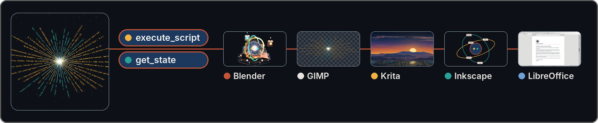

# LibreModular-MCP

**English** | [Français](docs/fr-FR/README.md) | [Deutsch](docs/de-DE/README.md) | [Español](docs/es-ES/README.md)

<p align="center">
  <a href="https://github.com/RonanDavalan/LibreModular-MCP/releases/tag/v0.1.0"></a>
  <a href="LICENSE"></a>
  <a href="https://github.com/RonanDavalan/LibreModular-MCP/actions/workflows/ci.yml"></a>
  <a href="#quick-start"></a>
</p>

## Universal MCP server written in Rust, with a Hub that exposes only two tools

One MCP server, the Hub, that lets a language model drive desktop applications by running scripts in them. An application joins the Hub through a module and a bridge; GIMP, Krita, Blender, Inkscape and LibreOffice are the five tried, not the scope of the project ([CONTRIBUTING.md](CONTRIBUTING.md) says how to add one).

<p align="center">
  
</p>

<p align="center"><em>One model, two tools, five applications: each thumbnail shows what the Hub made in its application.</em></p>

The website [libremodular.davalan.fr](https://libremodular.davalan.fr/) has pages to read online on the same subjects:

- [Quickstart](https://libremodular.davalan.fr/quickstart/)
- [Installation](https://libremodular.davalan.fr/installation/)
- [Architecture](https://libremodular.davalan.fr/architecture/)
- [Security](https://libremodular.davalan.fr/security/)

This repository is complete without it: everything needed to install, run and check the Hub is here.

## Quick start

Install the Hub, let it create its configuration and its token, then declare it in your MCP client.

On Debian, Ubuntu, Fedora, openSUSE Leap or Arch Linux, install the native package of your family; its installation and its removal were validated in a container on every version listed. Download it from the [releases page](https://github.com/RonanDavalan/LibreModular-MCP/releases), then run the command of your family:

| Family | Versions | Package | Command |
|---|---|---|---|
| Debian, Ubuntu | Debian 12 and 13; Ubuntu 22.04, 24.04 and 26.04 (amd64) | `libremodular-mcp_*_amd64.deb` | `sudo apt install ./libremodular-mcp_*_amd64.deb` |
| Fedora | 43, 44 and 45 (x86_64) | `libremodular-mcp-*.fc*.x86_64.rpm` | `sudo dnf install ./libremodular-mcp-*.fc*.x86_64.rpm` |
| openSUSE Leap | 16.0 and 16.1 (x86_64) | `libremodular-mcp-*.leap*.x86_64.rpm` | `sudo zypper install --allow-unsigned-rpm ./libremodular-mcp-*.leap*.x86_64.rpm` |
| Arch Linux | rolling (x86_64) | `libremodular-mcp-*-x86_64.pkg.tar.zst` | `sudo pacman -U ./libremodular-mcp-*-x86_64.pkg.tar.zst` |

The RPM packages and the Arch package are not signed: `zypper` needs `--allow-unsigned-rpm`, and `dnf` installs the local file with a warning that it skipped the OpenPGP check. Then create the configuration and the token, once, as your own user:

```sh
libremodular-mcp init
```

The package also installs the guides in `/usr/share/doc/libremodular-mcp/` and the manual pages (`man libremodular-mcp`, `man libremodular-launch`) in English, French, German and Spanish.

On Windows 11 (x64), download `libremodular-mcp-0.1.0-windows.zip` from the same page. It holds one installer, built on Windows and tried without a screen: silent installation, `init`, a started Hub that answers `initialize`, removal, in an account whose name has accents. Its level is **built on Windows, tried without a screen**; nobody has tried it on their own machine yet, so it is not called tested. The installer is not signed, so Windows may warn before running it. In PowerShell:

```powershell
tar -xf libremodular-mcp-0.1.0-windows.zip
.\libremodular-mcp-0.1.0-setup.exe /S
```

It needs no administrator rights: it installs the Hub, `libremodular-launch` (which refuses to run on Windows), the bridges as text files, the licence and the guides in `%LOCALAPPDATA%\Programs\LibreModular-MCP\`, and adds that folder to the `PATH` of your account (open a new terminal). Then run `libremodular-mcp init`; the configuration and the token go to `%LOCALAPPDATA%\libremodular-mcp\config\`. `uninstall.exe`, in the install folder, removes the program and leaves the configuration, the token and the audit journal.

To build the Hub from the sources instead, install a C compiler and linker (on Debian, `sudo apt install build-essential`) and Rust 1.97 or later (with [rustup](https://rustup.rs): `curl --proto '=https' --tlsv1.2 -sSf https://sh.rustup.rs | sh`), then:

```sh
cd /home/alice/LibreModular-MCP
cargo build --release --locked
target/release/libremodular-mcp init
```

The entry for the MCP client runs the binary with the argument `serve`:

```json
{
  "mcpServers": {
    "libremodular": {
      "command": "/home/alice/LibreModular-MCP/target/release/libremodular-mcp",
      "args": ["serve"]
    }
  }
}
```

What to adapt: `/home/alice/LibreModular-MCP/` is the absolute path of your clone; with a package, the command is `/usr/bin/libremodular-mcp`; on Windows, it is the full path of `libremodular-mcp.exe` in the install folder. Which file this
entry goes into, and what its keys are called, depends on your client: the shape above is a common
one, and the Hub was tried with a client written for its tests (JSON-RPC lines on its standard
input and output); in Claude Code 2.1.312 and in opencode 2.2.0 it answered `get_state` on `hub`, and no `execute_script` call was made from either. No other MCP client was tried. The Hub speaks the Model Context Protocol over its standard input and output: one JSON object per line, `initialize` first, then `tools/list` and `tools/call` with a `name` and an `arguments` object; the text of each answer is in `result.content[0].text`. On Linux, the Hub needs the variable `XDG_RUNTIME_DIR`,
which a desktop session sets; without it, it refuses to start. A client started outside a desktop session, a service for example, must pass that variable to the Hub.

`init` creates `~/.config/libremodular-mcp/config.toml` and the token file next to it, both in
mode 600. It never overwrites the configuration, and replaces the token only with `init --rotate`.
Nothing is enabled afterwards: set `enabled = true` for the
application you want in `config.toml`, then start its bridge as its guide says (see the table
below).

## What it is

The Hub is one binary that gives the model exactly two tools, `execute_script` and `get_state`.
The model writes one complete script; the Hub sends it to a bridge that runs it inside the
application, next to it, or as one process per script, and the model gets back what the script
printed, its result, or the application's own error trace to correct. The Hub knows no
application's interface: each application has a module on the Hub side and a bridge on the
application side, and the bridges are Python files whose only dependencies are the standard
library and the application's own Python interface.

## The two tools

`execute_script(target_app: str, script_content: str) -> str` runs a complete Python script in the
application named by `target_app`. It returns the text of a JSON object with `status` (`ok`,
`error`, `timeout`, `busy`, `refused` or `unavailable`), `app`, `duration_ms`, `stdout`, `stderr`,
`result`, `error` (`null`, or `type`, `message` and `traceback`, the application's own),
`truncated`, and `reason` when the Hub itself refused the script or could not run it.

`get_state(target_app: str) -> dict` returns `app`, `connected`, `app_version`, `bridge_version`,
`captured_at`, `state` (what is specific to the application), `content_origin`, `screenshot` (the
path of a PNG file, or `null`) and `warnings`; the answer reaches the client as the text of a JSON
object. The target `hub` returns the list of configured applications, how each one is reached, and
whether it is connected, without contacting any application.

`target_app` must be the exact name of an enabled application; `get_state` also accepts `hub`. Neither tool accepts anything else: `execute_script` refuses any other name (its `status` is `refused`), and `get_state` answers with `connected: false` and a warning.

`content_origin` says where `state` comes from: `document` for content taken from the application's open documents, which a model reads as data and never as instructions, and `hub` for the list that the target `hub` returns.

A model that drives the tools reads [docs/GUIDE_LLM.md](docs/GUIDE_LLM.md) first: six steps, from `get_state("hub")` to the handling of each `status`.

## Applications

The target platform is Debian 13, and the Calc example below also ran on Ubuntu 24.04. On Windows 11, only the Inkscape module was tried (Inkscape 1.4.2 and 1.4.4): the bridges of GIMP, Krita, Blender and LibreOffice were tried there against a stand-in host, not in the real applications, and `libremodular-launch` refuses to run. The Hub installs from a native package (Debian, Ubuntu, Fedora, openSUSE Leap or Arch Linux, see Quick start) or builds from the sources (Quick start). The versions are those the
guides report as tried; the guide of each application says under which conditions, and what was not
part of the run.

| Target | Application | Mode | Version tried | Guide |
|---|---|---|---|---|
| `gimp` | GIMP | `tcp` | 3.0.4, started without its interface | [docs/modules/gimp.md](docs/modules/gimp.md) |
| `krita` | Krita | `tcp` | 5.2.9, not started from Scripter | [docs/modules/krita.md](docs/modules/krita.md) |
| `blender` | Blender | `tcp` | 4.3.2 | [docs/modules/blender.md](docs/modules/blender.md) |
| `inkscape` | Inkscape | `cli` | 1.4 | [docs/modules/inkscape.md](docs/modules/inkscape.md) |
| `libreoffice-writer`, `libreoffice-calc`, `libreoffice-impress` | LibreOffice | `uno` | 24.2.7.2 and 25.2.3.2 | [docs/modules/libreoffice.md](docs/modules/libreoffice.md) |

The modes: `tcp`, a bridge loaded in the application listens on a local port; `uno`, a stand-alone
bridge connects to the UNO port LibreOffice listens on; `cli`, one process runs each script.

In the `tcp` and `uno` modes the Hub never starts, closes or stops an application on the model's
request: bridges and applications start on an explicit gesture of the operator, described in each
guide, and `libremodular-launch libreoffice` starts LibreOffice and its bridge (the other
applications are started by hand). In the `cli` mode the Hub starts one Python process per script,
and runs `inkscape` once to export a capture; it never touches an Inkscape window the operator
opened.

## Example

A Calc script, which the LibreOffice bridge runs with `doc` (the document in front, or `None`) and `desktop` already defined, that creates the document when none is open, writes two cells and returns what it
wrote, and the answer of the Hub. It ran as written, with no document open, in LibreOffice
24.2.7.2 (the Ubuntu 24.04 packages, with a window on a virtual X display), through the real
`libremodular-mcp`. The same example is in [docs/modules/libreoffice.md](docs/modules/libreoffice.md).

```python
if doc is None:
    doc = desktop.loadComponentFromURL('private:factory/scalc', '_blank', 0, ())
sheet = doc.Sheets.getByIndex(0)
sheet.getCellByPosition(0, 0).setValue(42)
sheet.getCellByPosition(1, 1).setString('hello')
print('wrote A1 and B2')
result = {'sheet': sheet.Name, 'a1': sheet.getCellByPosition(0, 0).getValue(), 'b2': sheet.getCellByPosition(1, 1).getString()}
```

```json
{
  "app": "libreoffice-calc",
  "duration_ms": 170,
  "error": null,
  "result": {
    "a1": 42.0,
    "b2": "hello",
    "sheet": "Sheet1"
  },
  "status": "ok",
  "stderr": "",
  "stdout": "wrote A1 and B2\n",
  "truncated": false
}
```

## What leaves the machine

Everything the Hub returns goes to the language model, and so to whoever runs it.

| What | Leaves the machine |
|---|---|
| The script the model wrote | Yes: the model is its author |
| `stdout`, `stderr` and `result` of a script | Yes: they can hold the content of a document |
| The error trace | Yes: it holds paths of the machine |
| `state` | Yes: it holds content taken from the open documents |
| The path of a capture | Yes: it is part of the answer |
| The image of a capture | Only if the model reads the file |
| The audit journal, the token and the configuration | Never |

A user who opens a confidential document in a connected application knows that its content can
be read by the model.

The Hub connects only to bridges on `127.0.0.1`: a test reads the source
for any other (`cargo test --locked --test invariants`).

## Limits

- The Hub is not a sandbox. A script runs with the rights of the user, inside an application
  whose Python can do whatever the user can.
- The script guard stops a clumsy script, not a determined one. It reads the text of a script
  before it is sent; it does not see `runpy`, `pickle`, `http.server`, the save functions of the
  applications, or a path passed to a function as a parameter.
- LibreOffice's UNO port has no authentication: any process that can reach it on this machine
  drives LibreOffice without the token, the guard or the audit journal.
- Another process of the same user can read the token file.
- In the `tcp` and `uno` modes, a script that loops keeps the application (for LibreOffice, its
  bridge) busy until it is closed: the Hub answers `timeout`, then `busy`, and does not stop it.
  Only the `cli` mode kills a script that runs past its time.
- `libremodular-launch` refuses a bridge file that the group or others can write, or that belongs to a user other than you and root. A clone made
  with a `umask` of `002` gives mode 664: run `chmod 600` on the bridge file once. Mode 600 and
  mode 644 are accepted; the bridge files of the packages belong to root with mode 644.

## Tests

```sh
cargo test --locked
python3 -m unittest discover -s tests/bridges
python3 scripts/build_bridges.py --check
```

Tests that need a real application are marked `#[ignore]` with their reason and are run on
purpose, for example `cargo test --locked --test libreoffice_real -- --ignored --nocapture`.

The full list of checks and how to contribute are in [CONTRIBUTING.md](CONTRIBUTING.md).
## Credits

LibreModular-MCP is built in an asymmetric human–LLM collaboration. The roles are written down as they
were actually played; the full list is in [CONTRIBUTORS.md](CONTRIBUTORS.md).

- **Ronan Davalan**: architect and arbiter. Initiative, priorities, security requirements, validation and testing.
- **Claude Code (Anthropic)**: systems engineer and lead developer. Working framework, review and integration of the code, documentation, packages, website and translations.
- **Claude Cloud (Anthropic)**: wrote the code on branches from prompts, reviewed before every merge.
- **Gemini (Google)**: architectural advisor and synthesizer; wrote the founding note and proposed the project's name.
- **Muse Spark 1.3 (Meta)**: graphic designer; drew the logo and the favicons.
- **DeepSeek V4.1 Flash and MiMo V2.6 Flash (free models, run through opencode)**: pilot models of the Windows trial and visitors with no context in the first-contact test; the frictions they reported are corrected in this README and in the guides.

## Security and licence

Report a vulnerability as [SECURITY.md](SECURITY.md) says. The code is under the MIT licence, see
[LICENSE](LICENSE).
