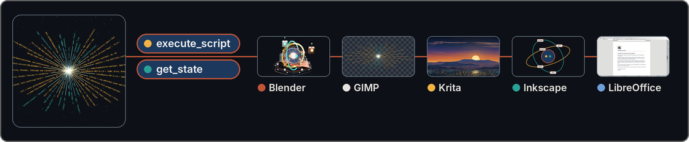

# LibreModular-MCP

[English](../../README.md) | [Français](../fr-FR/README.md) | [Deutsch](../de-DE/README.md) | **Español**

<p align="center">
  <a href="https://github.com/RonanDavalan/LibreModular-MCP/releases/tag/v0.1.0"></a>
  <a href="../../LICENSE"></a>
  <a href="https://github.com/RonanDavalan/LibreModular-MCP/actions/workflows/ci.yml"></a>
  <a href="#inicio-rápido"></a>
</p>

## Servidor MCP universal escrito en Rust, con un Hub que solo expone dos herramientas

Un servidor MCP que permite a un modelo de lenguaje manejar aplicaciones de escritorio ejecutando scripts en ellas.

<p align="center">
  
</p>

<p align="center"><em>Un modelo, dos herramientas, cinco aplicaciones: cada miniatura muestra lo que el Hub hizo en su aplicación.</em></p>

El sitio web [libremodular.davalan.fr](https://libremodular.davalan.fr/es/) ofrece páginas para leer en línea sobre los mismos temas:

- [Inicio rápido](https://libremodular.davalan.fr/es/quickstart/)
- [Instalación](https://libremodular.davalan.fr/es/installation/)
- [Arquitectura](https://libremodular.davalan.fr/es/architecture/)
- [Seguridad](https://libremodular.davalan.fr/es/security/)

Este repositorio se basta a sí mismo: todo lo necesario para instalar, iniciar y comprobar el Hub está aquí.

## Inicio rápido

Instale el Hub, deje que cree su configuración y su token, y declare después el Hub en su cliente MCP.

En Debian, Ubuntu, Fedora, openSUSE Leap o Arch Linux, instale el paquete nativo de su familia; su instalación y su desinstalación se han validado en un contenedor en cada versión indicada. Descárguelo de la [página de versiones](https://github.com/RonanDavalan/LibreModular-MCP/releases) y ejecute después el comando de su familia:

| Familia | Versiones | Paquete | Comando |
|---|---|---|---|
| Debian, Ubuntu | Debian 12 y 13; Ubuntu 22.04, 24.04 y 26.04 (amd64) | `libremodular-mcp_*_amd64.deb` | `sudo apt install ./libremodular-mcp_*_amd64.deb` |
| Fedora | 43, 44 y 45 (x86_64) | `libremodular-mcp-*.fc*.x86_64.rpm` | `sudo dnf install ./libremodular-mcp-*.fc*.x86_64.rpm` |
| openSUSE Leap | 16.0 y 16.1 (x86_64) | `libremodular-mcp-*.leap*.x86_64.rpm` | `sudo zypper install --allow-unsigned-rpm ./libremodular-mcp-*.leap*.x86_64.rpm` |
| Arch Linux | continuo (x86_64) | `libremodular-mcp-*-x86_64.pkg.tar.zst` | `sudo pacman -U ./libremodular-mcp-*-x86_64.pkg.tar.zst` |

Los paquetes RPM y el paquete de Arch no están firmados: `zypper` exige `--allow-unsigned-rpm`, y `dnf` instala el archivo local con un aviso de que omitió la comprobación de OpenPGP. Cree después la configuración y el token, una sola vez, con su propia cuenta:

```sh
libremodular-mcp init
```

El paquete instala también las guías en `/usr/share/doc/libremodular-mcp/` y las páginas de manual (`man libremodular-mcp`, `man libremodular-launch`) en inglés, francés, alemán y español.

En Windows 11 (x64), descargue `libremodular-mcp-0.1.0-windows.zip` desde la misma página. Contiene un único instalador, construido en Windows y probado sin pantalla: instalación silenciosa, `init`, un Hub iniciado que responde a `initialize`, desinstalación, en una cuenta cuyo nombre lleva acentos. Su nivel es **construido en Windows, probado sin pantalla**; nadie lo ha probado todavía en su propia máquina, por lo que no se llama probado. El instalador no está firmado: Windows puede mostrar una advertencia antes de ejecutarlo. En PowerShell:

```powershell
tar -xf libremodular-mcp-0.1.0-windows.zip
.\libremodular-mcp-0.1.0-setup.exe /S
```

No necesita derechos de administrador: instala el Hub, `libremodular-launch` (que se niega a ejecutarse en Windows), los puentes como archivos de texto, la licencia y las guías en `%LOCALAPPDATA%\Programs\LibreModular-MCP\`, y añade esa carpeta al `PATH` de su cuenta (abra una terminal nueva). Ejecute después `libremodular-mcp init`; la configuración y el token van a `%LOCALAPPDATA%\libremodular-mcp\config\`. `uninstall.exe`, en la carpeta de instalación, elimina el programa y deja la configuración, el token y el diario de auditoría.

Para compilar en su lugar el Hub desde las fuentes, instale un compilador y un enlazador de C (en Debian, `sudo apt install build-essential`) y Rust 1.97 o posterior (con [rustup](https://rustup.rs): `curl --proto '=https' --tlsv1.2 -sSf https://sh.rustup.rs | sh`), y ejecute después:

```sh
cd /home/alice/LibreModular-MCP
cargo build --release --locked
target/release/libremodular-mcp init
```

La entrada para el cliente MCP ejecuta el binario con el argumento `serve`:

```json
{
  "mcpServers": {
    "libremodular": {
      "command": "/home/alice/LibreModular-MCP/target/release/libremodular-mcp",
      "args": ["serve"]
    }
  }
}
```

Qué adaptar: `/home/alice/LibreModular-MCP/` es la ruta absoluta de su clon; con un paquete, el comando es `/usr/bin/libremodular-mcp`; en Windows, es la ruta completa de `libremodular-mcp.exe` en la carpeta de instalación. En qué archivo va esta entrada y cómo
se llaman sus claves depende de su cliente: la forma de arriba es habitual, y el Hub se probó con un cliente
escrito para sus pruebas (líneas JSON-RPC por su entrada y su salida estándar), no con un cliente MCP con nombre. El Hub habla el Model Context Protocol por su entrada y su salida estándar: un objeto JSON por línea, primero `initialize`, luego `tools/list` y `tools/call` con un `name` y un objeto `arguments`; el texto de cada respuesta está en `result.content[0].text`. En Linux, el Hub necesita la variable `XDG_RUNTIME_DIR`, que define una sesión de escritorio; sin ella, se niega a iniciarse. Un cliente que se inicia fuera de una sesión de escritorio, un servicio por ejemplo, debe pasar esa variable al Hub.

`init` crea `~/.config/libremodular-mcp/config.toml` y el archivo de token a su lado, ambos con modo 600. Nunca
sobrescribe la configuración y solo sustituye el token con `init --rotate`. Después no queda nada activado: ponga
`enabled = true` en la aplicación que quiera dentro de `config.toml` e inicie su puente como dice su guía
(véase la tabla de abajo).

## Qué es

El Hub es un único binario que da al modelo exactamente dos herramientas, `execute_script` y `get_state`. El modelo
escribe un script completo; el Hub lo envía a un puente que lo ejecuta dentro de la aplicación, junto a ella o como
un proceso por script, y el modelo recibe lo que el script imprimió, su resultado o la traza de error propia de la
aplicación, para corregirla. El Hub no conoce la interfaz de ninguna aplicación: cada aplicación tiene un módulo
del lado del Hub y un puente del lado de la aplicación, y los puentes son archivos de Python cuyas únicas
dependencias son la biblioteca estándar y la interfaz de Python de la propia aplicación.

## Las dos herramientas

`execute_script(target_app: str, script_content: str) -> str` ejecuta un script de Python completo en la
aplicación que nombra `target_app`. Devuelve el texto de un objeto JSON con `status` (`ok`, `error`, `timeout`,
`busy`, `refused` o `unavailable`), `app`, `duration_ms`, `stdout`, `stderr`, `result`, `error` (`null`, o `type`,
`message` y `traceback`, los de la aplicación), `truncated` y `reason` cuando el propio Hub rechazó el script o no
pudo ejecutarlo.

`get_state(target_app: str) -> dict` devuelve `app`, `connected`, `app_version`, `bridge_version`, `captured_at`,
`state` (lo propio de la aplicación), `content_origin`, `screenshot` (la ruta de un archivo PNG, o `null`) y
`warnings`; la respuesta llega al cliente como el texto de un objeto JSON. El destino `hub` devuelve la lista de
aplicaciones configuradas, cómo se llega a cada una y si está conectada, sin contactar con ninguna aplicación.

`target_app` debe ser el nombre exacto de una aplicación activada; `get_state` acepta también `hub`. Ninguna de las dos herramientas acepta otra cosa: `execute_script` rechaza cualquier otro nombre (su `status` es `refused`), y `get_state` responde con `connected: false` y una advertencia.

`content_origin` dice de dónde viene `state`: `document` para contenido tomado de los documentos abiertos de la aplicación, que un modelo lee como un dato y nunca como una instrucción, y `hub` para la lista que devuelve el destino `hub`.

Un modelo que maneja las herramientas lee primero [docs/es-ES/GUIDE_LLM.md](GUIDE_LLM.md): seis pasos, de `get_state("hub")` al tratamiento de cada `status`.

## Aplicaciones

La plataforma prevista es Debian 13, y el ejemplo de Calc de abajo también se ejecutó en Ubuntu 24.04. En Windows 11 solo se probó el módulo de Inkscape (Inkscape 1.4.2 y 1.4.4): los puentes de GIMP, Krita, Blender y LibreOffice se probaron allí contra un anfitrión simulado, no en las aplicaciones reales, y `libremodular-launch` se niega a ejecutarse. El Hub se instala desde un paquete nativo (Debian, Ubuntu, Fedora, openSUSE Leap o Arch Linux, véase Inicio rápido) o se compila desde las fuentes (Inicio rápido). Las versiones son las
que las guías dan como probadas; la guía de cada aplicación dice en qué condiciones y qué no formó parte de la
prueba.

| Destino | Aplicación | Modo | Versión probada | Guía |
|---|---|---|---|---|
| `gimp` | GIMP | `tcp` | 3.0.4, iniciado sin su interfaz | [docs/es-ES/modules/gimp.md](modules/gimp.md) |
| `krita` | Krita | `tcp` | 5.2.9, no iniciado desde Scripter | [docs/es-ES/modules/krita.md](modules/krita.md) |
| `blender` | Blender | `tcp` | 4.3.2 | [docs/es-ES/modules/blender.md](modules/blender.md) |
| `inkscape` | Inkscape | `cli` | 1.4 | [docs/es-ES/modules/inkscape.md](modules/inkscape.md) |
| `libreoffice-writer`, `libreoffice-calc`, `libreoffice-impress` | LibreOffice | `uno` | 24.2.7.2 y 25.2.3.2 | [docs/es-ES/modules/libreoffice.md](modules/libreoffice.md) |

Los modos: `tcp`, un puente cargado en la aplicación escucha en un puerto local; `uno`, un puente independiente se
conecta al puerto UNO en el que escucha LibreOffice; `cli`, un proceso ejecuta cada script.

En los modos `tcp` y `uno`, el Hub nunca inicia, cierra ni detiene una aplicación a petición del modelo: los
puentes y las aplicaciones se inician con un gesto explícito del operador, descrito en cada guía, y
`libremodular-launch libreoffice` inicia LibreOffice y su puente (las demás aplicaciones se inician a mano). En el
modo `cli`, el Hub inicia un proceso de Python por script y ejecuta `inkscape` una vez para exportar una captura;
nunca toca una ventana de Inkscape que el operador haya abierto.

## Ejemplo

Un script de Calc, que el puente de LibreOffice ejecuta con `doc` (el documento en primer plano, o `None`) y `desktop` ya definidos, que crea el documento cuando no hay ninguno abierto, escribe dos celdas y devuelve lo que
escribió, y la respuesta del Hub. Se ejecutó tal cual, sin documento abierto, en LibreOffice 24.2.7.2 (los paquetes
de Ubuntu 24.04, con una ventana en una pantalla X virtual), a través del verdadero `libremodular-mcp`. El mismo
ejemplo está en [docs/es-ES/modules/libreoffice.md](modules/libreoffice.md).

```python
if doc is None:
    doc = desktop.loadComponentFromURL('private:factory/scalc', '_blank', 0, ())
sheet = doc.Sheets.getByIndex(0)
sheet.getCellByPosition(0, 0).setValue(42)
sheet.getCellByPosition(1, 1).setString('hello')
print('wrote A1 and B2')
result = {'sheet': sheet.Name, 'a1': sheet.getCellByPosition(0, 0).getValue(), 'b2': sheet.getCellByPosition(1, 1).getString()}
```

```json
{
  "app": "libreoffice-calc",
  "duration_ms": 170,
  "error": null,
  "result": {
    "a1": 42.0,
    "b2": "hello",
    "sheet": "Sheet1"
  },
  "status": "ok",
  "stderr": "",
  "stdout": "wrote A1 and B2\n",
  "truncated": false
}
```

## Lo que sale de la máquina

Todo lo que devuelve el Hub va al modelo de lenguaje, y por tanto a quien lo ejecuta.

| Qué | Sale de la máquina |
|---|---|
| El script que escribió el modelo | Sí: el modelo es su autor |
| `stdout`, `stderr` y `result` de un script | Sí: pueden contener el contenido de un documento |
| La traza de error | Sí: contiene rutas de la máquina |
| `state` | Sí: contiene contenido tomado de los documentos abiertos |
| La ruta de una captura | Sí: forma parte de la respuesta |
| La imagen de una captura | Solo si el modelo lee el archivo |
| El diario de auditoría, el token y la configuración | Nunca |

Un usuario que abre un documento confidencial en una aplicación conectada sabe que el modelo puede leer su
contenido.

El Hub solo se conecta a los puentes en `127.0.0.1`: una prueba lee el código fuente en
busca de cualquier otra (`cargo test --locked --test invariants`).

## Límites

- El Hub no es un entorno aislado. Un script se ejecuta con los derechos del usuario, dentro de una aplicación cuyo
  Python puede hacer todo lo que puede el usuario.
- La compuerta de scripts detiene un script torpe, no uno decidido. Lee el texto de un script antes de enviarlo; no
  ve `runpy`, `pickle`, `http.server`, las funciones de guardado de las aplicaciones ni una ruta pasada como
  parámetro a una función.
- El puerto UNO de LibreOffice no tiene autenticación: cualquier proceso que pueda alcanzarlo en esta máquina maneja
  LibreOffice sin el token, la compuerta ni el diario de auditoría.
- Otro proceso del mismo usuario puede leer el archivo del token.
- En los modos `tcp` y `uno`, un script que entra en bucle mantiene ocupada la aplicación (en LibreOffice, su
  puente) hasta que se cierra: el Hub responde `timeout`, después `busy`, y no lo detiene. Solo el modo `cli` mata
  un script que supera su tiempo.
- `libremodular-launch` rechaza un archivo de puente en el que el grupo u otros puedan escribir, o que pertenezca a otro usuario que no sea usted ni root. Un clon hecho con
  una `umask` de `002` da el modo 664: ejecute `chmod 600` en el archivo del puente una vez. Los modos 600 y 644 se
  aceptan; los archivos de puente de los paquetes pertenecen a root con el modo 644.

## Pruebas

```sh
cargo test --locked
python3 -m unittest discover -s tests/bridges
python3 scripts/build_bridges.py --check
```

Las pruebas que necesitan una aplicación real están marcadas con `#[ignore]` y su motivo, y se ejecutan a propósito,
por ejemplo `cargo test --locked --test libreoffice_real -- --ignored --nocapture`.

La lista completa de comprobaciones y cómo contribuir están en [CONTRIBUTING.md](../../CONTRIBUTING.md) (en inglés).

## Créditos

LibreModular-MCP se construye en una colaboración asimétrica entre humano y LLM. Los roles están escritos tal como
se desempeñaron realmente; la lista completa está en [CONTRIBUTORS.md](../../CONTRIBUTORS.md).

- **Ronan Davalan**: arquitecto y árbitro. Iniciativa, prioridades, requisitos de seguridad, validación y pruebas.
- **Claude Code (Anthropic)**: ingeniero de sistemas y desarrollador principal. Marco de trabajo, revisión e integración del código, documentación, paquetes, sitio web y traducciones.
- **Claude Cloud (Anthropic)**: escribió el código en ramas a partir de instrucciones, revisado antes de cada fusión.
- **Gemini (Google)**: asesor de arquitectura y sintetizador; escribió la nota fundacional y propuso el nombre del proyecto.
- **Muse Spark 1.3 (Meta)**: diseñador gráfico; dibujó el logotipo y los favicons.
- **DeepSeek V4.1 Flash y MiMo V2.6 Flash (modelos gratuitos, mediante opencode)**: modelos piloto de la prueba en Windows y visitantes sin contexto de la prueba de primer contacto; los puntos de fricción que comunicaron están corregidos en este README y en las guías.

## Seguridad y licencia

Notifique una vulnerabilidad como indica [SECURITY.md](../../SECURITY.md). El código tiene licencia MIT, véase
[LICENSE](../../LICENSE).
